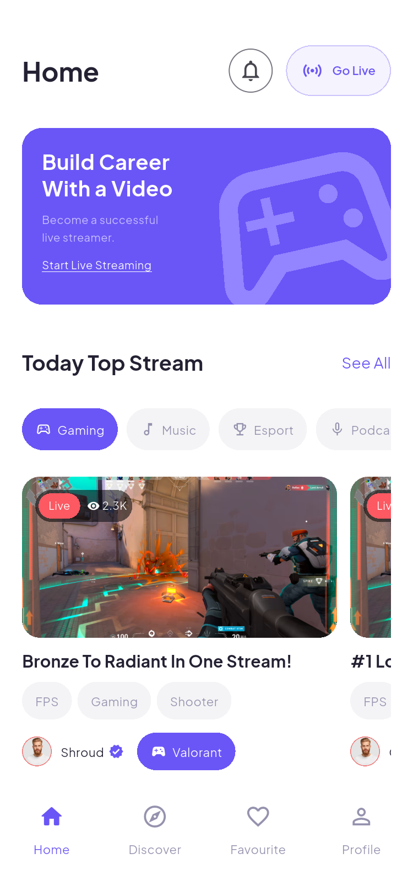
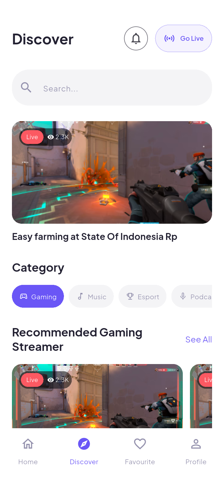
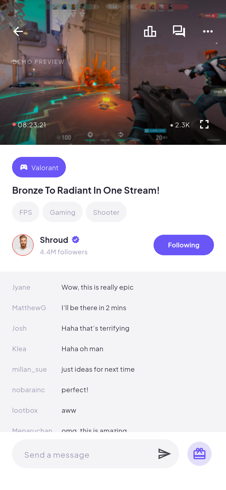
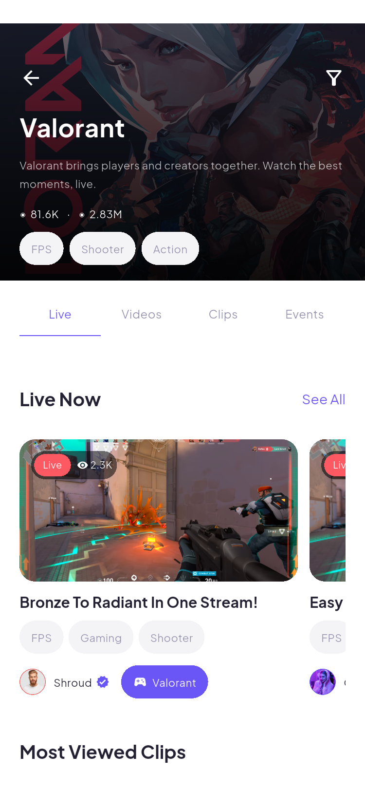
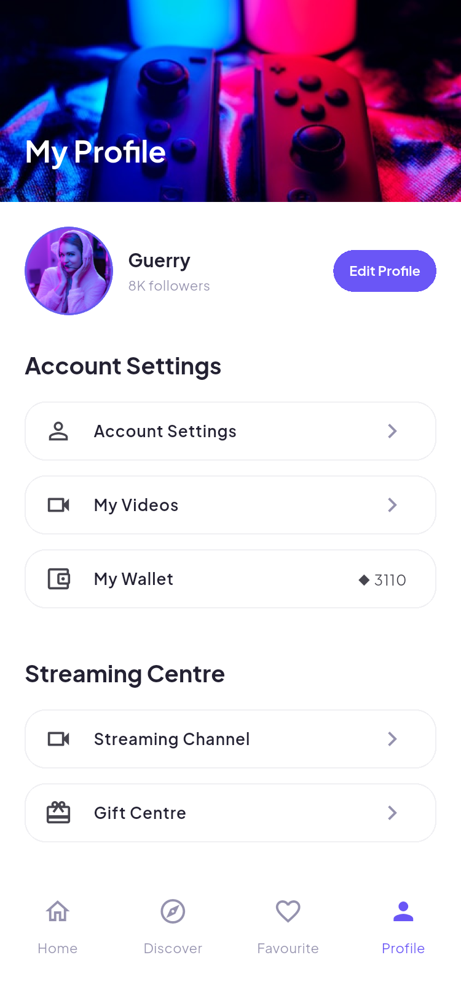
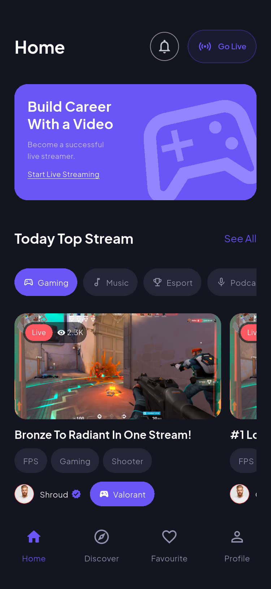

# Beatrix · Flutter 直播社区应用

根据 Pixso 文件 **Beatrix - Live Streaming App** 的 Design 页面实现。保留紫色品牌色、Plus Jakarta Sans 字体、浅色／深色主题、横向直播卡片和四栏底部导航。

这是可运行的 **本地交互演示版**：界面使用真实 Flutter 组件，支持页面导航、搜索、关注、聊天输入、礼物余额、资料编辑和开播管理。视频区域显示设计稿中导出的静态预览；尚未接入账号服务器、推拉流、实时聊天室或支付服务。

## 主要界面

下列图片来自 Android 模拟器中运行的应用，点击可查看原图。截图是 Flutter 应用画面，不包含 Android 系统状态栏。

| 首页 | 发现 | 直播间 |
| --- | --- | --- |
|  |  |  |

| 游戏分类 | 个人中心 | 深色首页 |
| --- | --- | --- |
|  |  |  |

完整页面截图见 [界面截图索引](docs/SCREENSHOTS.md)，架构细节见 [项目结构与架构说明](docs/ARCHITECTURE.md)。

可直接安装体验：[Beatrix-1.0.0.apk](dist/Beatrix-1.0.0.apk)（Android Release 预览包，约 52.8 MB）。

## 功能范围

| 模块 | 已实现的界面与交互 |
| --- | --- |
| 进入应用 | 引导、登录、注册、注册成功；必填、邮箱、密码长度、条款勾选校验 |
| 首页 | 直播分类筛选、直播横滑列表、主播入口、游戏列表、消息通知、Go Live |
| 发现与搜索 | 最近搜索、建议词、Top／Channels／Categories／Videos 结果、无结果提示 |
| 游戏详情 | Live／Videos／Clips／Events 页签、直播排序、活动详情和本次会话 RSVP |
| 主播详情 | Broadcast／Clips／About、关注和取消关注 |
| 直播间 | 静态游戏预览、横屏全屏、排行榜、输入并发送本地聊天、赠送虚拟礼物 |
| Favourite | 继续观看示例列表、关注主播列表；关注状态跨页面同步 |
| 个人中心 | 资料与账号编辑、钱包与礼物记录、我的视频、帮助、服务说明、隐私和退出 |
| 开播管理 | 开播面板、本地开始／结束状态、标题／分类／游戏／语言偏好保存 |
| 主题 | 全局浅色／深色切换，重启后恢复 |

登录使用任意非空用户名和至少 6 位密码，仅校验表单并进入本地演示，不验证真实身份。默认示例资料为 Guerry。Google／Discord 按钮会说明尚未接入认证服务，不会跳转或伪造第三方登录。

## 项目结构

```text
Beatrix/
├─ lib/
│  ├─ main.dart                  # 初始化本地状态与系统栏
│  ├─ app.dart                   # 应用、主题切换、集中式路由
│  ├─ core/
│  │  ├─ app_state.dart          # 共享状态、本地持久化、业务操作
│  │  ├─ catalog.dart            # Game / Stream / Gift 与演示目录
│  │  └─ theme.dart              # 色彩、字体、表单、按钮主题
│  ├─ widgets/
│  │  └─ common.dart             # 图片、头像、标签、直播卡片、列表等
│  └─ features/
│     ├─ auth/auth_pages.dart    # 引导与登录注册
│     ├─ home/shell_page.dart    # 四个主导航入口、首页、发现、关注
│     ├─ browse/browse_pages.dart# 搜索、游戏、主播与活动
│     ├─ live/live_pages.dart    # 直播间、礼物、排行、横屏
│     ├─ live/dashboard_pages.dart # 开播管理和偏好表单
│     └─ profile/profile_pages.dart # 个人中心及设置
├─ assets/
│  ├─ images/                    # Pixso 节点导出的本地 PNG
│  └─ fonts/                     # Jakarta 字体及 OFL 授权
├─ android/                      # Android 原生工程与品牌图标
├─ web/                          # Flutter Web 启动工程
├─ test/                         # 状态与组件测试
├─ integration_test/             # 模拟器流程、主题布局检查与截图
├─ test_driver/screenshots.dart  # 将截图保存到电脑
├─ docs/
│  ├─ ARCHITECTURE.md            # 架构、状态、路由与接入建议
│  ├─ SCREENSHOTS.md             # 所有运行截图索引
│  ├─ VALIDATION.md              # 实际验证记录
│  ├─ reference/                 # Pixso 原始参考图
│  └─ screenshots/               # 应用运行截图
└─ pubspec.yaml
```

## 运行

开发环境：Flutter 3.47.7、Dart 3.13.5；Android 模拟器使用 Android 15 / API 35。

```powershell
flutter pub get
flutter devices
flutter run -d emulator-5554
```

可用任意 Android 真机或模拟器替换设备 ID。也保留 Web 工程，可使用 `flutter run -d chrome` 预览；本次实际验收平台是 Android。当前不包含 iOS 原生工程及 iOS 构建验证。

测试：

```powershell
flutter analyze
flutter test --concurrency=1
flutter test integration_test/layout_test.dart -d emulator-5554
flutter drive --driver=test_driver/screenshots.dart --target=integration_test/app_test.dart -d emulator-5554
```

截图流程会清空 **Beatrix 演示应用自身** 的本地偏好，以生成可重复的初始界面；不会清理其他应用的数据。竖屏截图分辨率为 750 × 1624，横屏为 1624 × 750。重新采集可覆盖 `docs/screenshots/` 中同名文件。

构建可安装预览包：

```powershell
flutter build apk --release
```

Android 工程沿用本地调试签名用于预览安装。正式上架前需配置自己的签名、身份认证和服务端接口。[验证记录](docs/VALIDATION.md)说明本次实际生成的安装包及测试结果。

## 数据与演示边界

- **本地保存**：主题、是否记住演示登录、昵称、简介、邮箱、关注、最近搜索、礼物余额和记录、开播偏好。
- **仅本次运行**：聊天消息、开始／结束演示直播的状态、活动 RSVP。
- **示例内容**：直播与视频目录、观看历史、人数、排行榜、通知、主播资料和活动时间。
- **未接入的服务**：直播视频、麦克风／摄像头采集、远程聊天、充值、真实账号、第三方 OAuth、客服消息和日历通知。
- 密码不会存储；演示钻石不涉及真实交易。清除应用数据会恢复默认资料及 3,110 钻石。

## 精简原则

只使用 Flutter SDK 和一个运行时插件 `shared_preferences`。通过 `ChangeNotifier + InheritedNotifier` 共享状态，统一路由与主题，复用卡片、头像、标签、表单和列表，合并设计稿中的空白／填写、浅色／深色等状态变体，避免为每一张设计稿复制一个页面。已移除默认计数器示例及无用依赖。

## 素材

界面图片来自当前 Pixso 参考文件，原始节点与导出说明见 [设计来源](docs/REFERENCE.md)。部分参考节点为空白、缺字或重复，应用使用可用原图和 Material 图标补全；这是布局和交互还原，并非逐像素截图贴图。字体遵循 [SIL Open Font License](assets/fonts/OFL.txt)；设计图、人物和游戏图片的使用权需按原设计资产授权管理。
